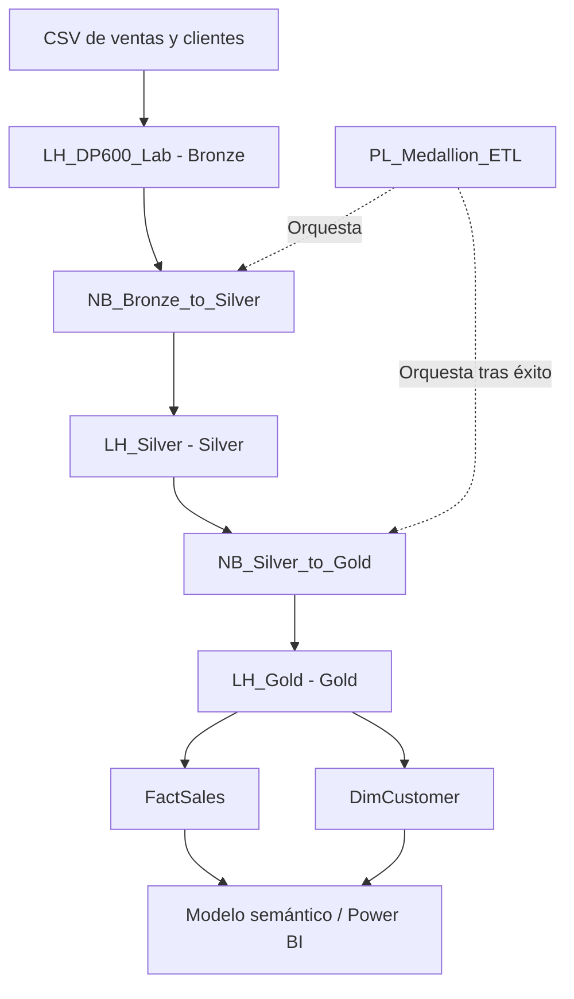

# Microsoft Fabric – Medallion Architecture

**Implementación práctica de una arquitectura Medallion (Bronze, Silver y Gold) utilizando Microsoft Fabric, Lakehouse, OneLake, Delta Lake, PySpark y Data Factory Pipelines.**

Este proyecto demuestra un flujo de ingeniería de datos de extremo a extremo: desde la ingesta de ficheros CSV hasta la generación de tablas analíticas organizadas en un modelo dimensional.

> **Estado del proyecto:** laboratorio funcional, ejecutado correctamente en un entorno Microsoft Fabric Trial. El repositorio se encuentra en evolución y se ampliará con notebooks exportados, datos de ejemplo y evidencias de ejecución.

## 1. Objetivos del proyecto

- Implementar una arquitectura Medallion con tres Lakehouses.
- Transformar y validar datos mediante PySpark.
- Persistir los datos en formato Delta Lake.
- Construir una capa Gold con tablas de hechos y dimensiones.
- Orquestar las transformaciones mediante un Data Factory Pipeline.
- Documentar el flujo y las decisiones técnicas.

## 2. Arquitectura

La solución se organiza en tres capas de datos independientes:

| Capa | Lakehouse | Contenido |
|---|---|---|
| Bronze | `LH_DP600_Lab` | CSV originales y tablas `Bronze_Sales`, `Bronze_Customers` |
| Silver | `LH_Silver` | Tablas depuradas `Sales_Clean`, `Customers_Clean` |
| Gold | `LH_Gold` | Modelo dimensional: `FactSales`, `DimCustomer` |

### Diagrama de arquitectura



El pipeline `PL_Medallion_ETL` ejecuta los notebooks en secuencia, utilizando la dependencia de éxito entre ambas actividades.

## 3. Tecnologías utilizadas

- **Microsoft Fabric:** plataforma de analítica.
- **OneLake:** almacenamiento unificado de datos.
- **Lakehouse:** organización de datos por capas.
- **Delta Lake:** persistencia transaccional de tablas.
- **Apache Spark / PySpark:** lectura, transformación y escritura de datos.
- **Data Factory Pipelines:** orquestación del proceso ETL.
- **Modelado dimensional:** separación de hechos y dimensiones.

## 4. Flujo de datos

1. **Ingesta:** lectura de los CSV originales de ventas y clientes.
2. **Bronze:** persistencia de los datos de aterrizaje en tablas Delta.
3. **Silver:** conversión de tipos, eliminación de duplicados, validación de campos obligatorios y aplicación de reglas de calidad.
4. **Gold:** selección y organización de los datos en tablas de hechos y dimensiones.
5. **Orquestación:** ejecución secuencial de los notebooks mediante el pipeline.

## Modelo dimensional

La capa Gold contiene dos tablas Delta:

- **FactSales:** datos transaccionales de ventas.
- **DimCustomer:** información descriptiva de clientes.

Ambas tablas comparten la clave `CustomerId` y están preparadas para su integración en un modelo semántico de Power BI.

Relación prevista:

`DimCustomer[CustomerId]` (1) → `FactSales[CustomerId]` (*)

La creación del modelo semántico y la configuración de las relaciones se abordarán en una siguiente fase del proyecto.

## 6. Resultados del laboratorio

El proceso se ha ejecutado correctamente y ha generado las siguientes tablas:

| Capa | Tabla | Registros |
|---|---|---:|
| Bronze | Bronze_Sales | 10 |
| Bronze | Bronze_Customers | 6 |
| Silver | Sales_Clean | 10 |
| Silver | Customers_Clean | 6 |
| Gold | FactSales | 10 |
| Gold | DimCustomer | 6 |

Los recuentos corresponden al conjunto de datos ficticio utilizado en el laboratorio.

## 7. Decisiones técnicas y consideraciones

- Se utilizan tres Lakehouses para separar responsabilidades y capas de procesamiento.
- Las tablas persistentes se almacenan en formato Delta.
- Las transformaciones se implementan mediante notebooks PySpark.
- Se ha utilizado `overwrite` para facilitar la reproducibilidad del laboratorio. En un entorno productivo sería necesario evaluar cargas incrementales, idempotencia y estrategias de actualización.
- Los errores `TooManyRequestsForCapacity` (HTTP 430) observados durante las primeras ejecuciones evidenciaron las limitaciones de capacidad y concurrencia del entorno Trial. Finalmente, el pipeline se ejecutó correctamente.
- Las rutas ABFS y configuraciones específicas del entorno no se incluyen en el repositorio.

## 8. Estructura del repositorio

```text
fabric-medallion-architecture/
├── README.md
├── docs/
│   ├── architecture.md
│   ├── data-flow.md
│   ├── implementation-notes.md
│   └── images/
├── notebooks/
├── data/
│   └── sample/
├── pipelines/
│   └── pipeline-design.md
└── .gitignore
```

## 9. Próximas mejoras

- Incorporar los notebooks exportados desde Microsoft Fabric (`.ipynb`).
- Añadir ficheros CSV ficticios para reproducir el laboratorio.
- Documentar las reglas de calidad y las transformaciones PySpark.
- Añadir capturas de los Lakehouses y de las ejecuciones del pipeline.
- Incorporar una dimensión calendario.
- Implementar pruebas de calidad de datos.
- Explorar cargas incrementales y estrategias de actualización.

---

**Proyecto personal de aprendizaje y portfolio técnico – Microsoft Fabric / DP-600.**