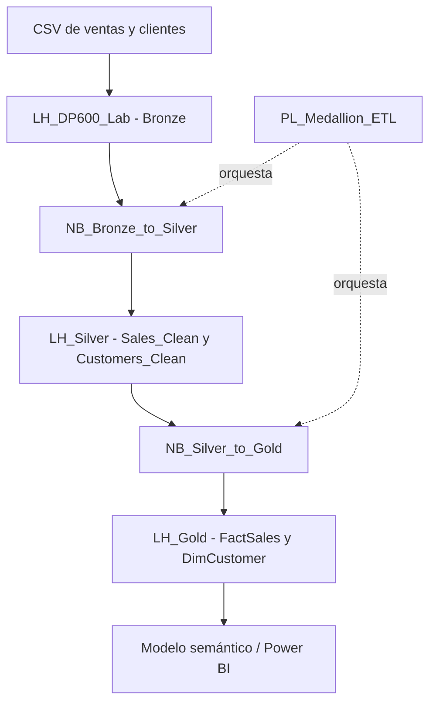

# Arquitectura Medallion en Microsoft Fabric

Proyecto práctico de ingeniería de datos que implementa una arquitectura Medallion (Bronze, Silver y Gold) en Microsoft Fabric mediante Lakehouse, OneLake, Delta Lake, PySpark y Data Factory Pipelines.

> **Estado:** laboratorio funcional en entorno Microsoft Fabric Trial. En próximas iteraciones se incorporarán los notebooks exportados, datos ficticios y capturas del entorno.

## Arquitectura

- **Bronze — `LH_DP600_Lab`:** CSV originales y tablas Delta de aterrizaje (`Bronze_Sales`, `Bronze_Customers`).
- **Silver — `LH_Silver`:** datos tipados, depurados y validados (`Sales_Clean`, `Customers_Clean`).
- **Gold — `LH_Gold`:** modelo dimensional analítico (`FactSales`, `DimCustomer`).
- **Orquestación — `PL_Medallion_ETL`:** ejecuta los notebooks de transformación en secuencia.

## Tecnologías

Microsoft Fabric Lakehouse · OneLake · Delta Lake · Apache Spark/PySpark · Data Factory Pipelines · Modelado dimensional.

## Flujo de datos

1. Ingesta de CSV originales en Bronze.
2. Persistencia de tablas Bronze en Delta.
3. Limpieza y validación con PySpark para producir Silver.
4. Construcción de hechos y dimensiones para Gold.
5. Orquestación mediante un Pipeline.

## Modelo dimensional

- `FactSales`: una fila por venta; contiene claves, atributos transaccionales y medidas.
- `DimCustomer`: una fila por cliente; contiene atributos descriptivos.
- Relación prevista en el modelo semántico: `DimCustomer[CustomerId]` (1) → `FactSales[CustomerId]` (*).

## Ejecución

Este laboratorio se ejecuta dentro de Microsoft Fabric con los Lakehouses asociados y una sesión Spark disponible. Las rutas ABFS son específicas de cada entorno; no se incluyen identificadores de tenant, workspace o capacidad.

Consulta `docs/` y `pipelines/pipeline-design.md`.

## Consideraciones

- Los datos publicados deben ser ficticios y no contener información personal.
- `overwrite` se utilizó para hacer reproducible el laboratorio; producción requiere estrategia incremental, idempotencia, control de calidad y gestión de errores.
- `TooManyRequestsForCapacity` (HTTP 430) indica que la capacidad no pudo admitir un trabajo Spark en ese momento; no implica necesariamente un error del código.
- No publicar secretos, tokens, claves, identificadores privados ni rutas ABFS del entorno.

## Próximas mejoras

- Incorporar notebooks exportados desde Fabric (`.ipynb`).
- Añadir CSV ficticios de muestra.
- Incorporar capturas del Pipeline y tablas Delta.
- Añadir dimensión calendario y pruebas de calidad.
