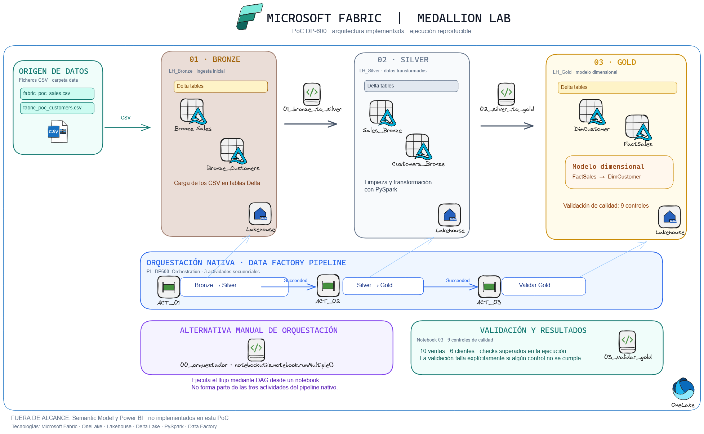

# Microsoft Fabric – Medallion Architecture

PoC de ingeniería de datos con **Microsoft Fabric**, basada en una arquitectura Medallion (Bronze, Silver y Gold), utilizando Lakehouse, OneLake, Delta Lake, Apache Spark, PySpark y Data Factory Pipelines.

El proyecto implementa un flujo de procesamiento de extremo a extremo: desde la ingesta de ficheros CSV hasta la generación y validación de tablas analíticas organizadas en un modelo dimensional.

**Estado:** PoC implementada y ejecutada correctamente en Microsoft Fabric Trial.

## Resumen del proyecto

| Componente | Implementación |
|---|---|
| Plataforma | Microsoft Fabric |
| Almacenamiento | OneLake |
| Arquitectura | Medallion |
| Lakehouses | 3 |
| Procesamiento | Apache Spark / PySpark |
| Formato de tablas | Delta Lake |
| Notebooks | 4 |
| Orquestación principal | Data Factory Pipeline |
| Validaciones de calidad | 9 |
| Modelo analítico | FactSales y DimCustomer |

## 1. Objetivos

- Implementar una arquitectura Medallion utilizando tres Lakehouses.
- Comprender la organización y el almacenamiento de datos en OneLake.
- Desarrollar transformaciones de datos mediante notebooks PySpark.
- Persistir los resultados en tablas Delta.
- Construir una capa Gold mediante un modelo dimensional.
- Orquestar los procesos mediante una canalización nativa de Microsoft Fabric.
- Incorporar controles de calidad e integridad de datos.
- Documentar la solución y mantener el código bajo control de versiones con Git.

## 2. Arquitectura de la solución

La solución implementa una arquitectura Medallion en Microsoft Fabric,
organizada en tres capas: Bronze, Silver y Gold.



| Capa | Lakehouse | Contenido |
|---|---|---|
| Bronze | `LH_Bronze` | Datos originales y tablas Bronze |
| Silver | `LH_Silver` | Datos depurados y transformados |
| Gold | `LH_Gold` | Modelo dimensional y tablas analíticas |

### Flujo de datos

1. Ingesta de ficheros CSV.
2. Persistencia de los datos originales en Bronze.
3. Limpieza, transformación y validación en Silver.
4. Construcción de hechos y dimensiones en Gold.
5. Validación de calidad de las tablas Gold.

## 3. Tecnologías utilizadas

- **Microsoft Fabric:** plataforma unificada de analítica.
- **OneLake:** almacenamiento unificado de datos.
- **Lakehouse:** organización de los datos por capas.
- **Delta Lake:** formato de almacenamiento transaccional.
- **Apache Spark / PySpark:** procesamiento y transformación distribuida.
- **Data Factory Pipelines:** orquestación de actividades.
- **Git y GitHub:** control de versiones y documentación.
- **Modelado dimensional:** organización de datos mediante hechos y dimensiones.

## 4. Datos de origen e ingesta

El laboratorio utiliza dos ficheros CSV ficticios incluidos en el repositorio:

| Fichero | Descripción |
|---|---|
| `fabric_poc_sales.csv` | Datos de ventas |
| `fabric_poc_customers.csv` | Datos de clientes |

Los ficheros se encuentran en `data/` y se utilizan como origen de la capa Bronze.

Las tablas generadas son:

- `Bronze_Sales`
- `Bronze_Customers`

## 5. Procesamiento mediante notebooks PySpark

El procesamiento se implementa mediante cuatro notebooks.

| Notebook | Responsabilidad |
|---|---|
| `00_orquestador.ipynb` | Orquestación alternativa mediante DAG y `notebookutils.notebook.runMultiple()` |
| `01_bronze_to_silver.ipynb` | Limpieza, transformación y persistencia de Bronze a Silver |
| `02_silver_to_gold.ipynb` | Construcción de las tablas de hechos y dimensiones |
| `03_validar_gold.ipynb` | Comprobaciones de calidad e integridad de Gold |

### Capa Silver

Se generan las tablas:

- `Sales_Bronze`
- `Customers_Bronze`

En esta etapa se realizan transformaciones y controles de calidad sobre los datos de origen.

### Capa Gold

Se construyen dos tablas Delta:

- `FactSales`: información transaccional de ventas.
- `DimCustomer`: información descriptiva de clientes.

Ambas tablas comparten la clave `CustomerId`.

Relación prevista para el modelo analítico:

`DimCustomer[CustomerId]` (1) → `FactSales[CustomerId]` (*)

La creación y configuración del modelo semántico de Power BI no forma parte del alcance de esta PoC.

## 6. Orquestación mediante Data Factory Pipeline

La canalización principal de Microsoft Fabric se denomina:

`PL_DP600_Orchestration`

Coordina la ejecución secuencial de los tres notebooks de transformación y validación.

| Actividad | Notebook asociado | Responsabilidad |
|---|---|---|
| `ACT_01_Bronze_to_Silver` | `01_bronze_to_silver` | Transformación Bronze → Silver |
| `ACT_02_Silver_to_Gold` | `02_silver_to_gold` | Construcción de Gold |
| `ACT_03_Validar_Gold` | `03_validar_gold` | Validación de calidad |

Las dependencias entre actividades utilizan la condición `Succeeded`. Por tanto, cada etapa posterior solo se ejecuta cuando la anterior finaliza correctamente.

### Orquestación alternativa mediante DAG

El notebook `00_orquestador.ipynb` implementa una alternativa programática de orquestación mediante `notebookutils.notebook.runMultiple()`.

Se ejecuta independientemente de la canalización nativa y permite demostrar otra modalidad de coordinación de notebooks en Fabric.

## 7. Validaciones de calidad de datos

El notebook `03_validar_gold.ipynb` realiza nueve comprobaciones:

1. FactSales no está vacía.
2. DimCustomer no está vacía.
3. FactSales no contiene claves nulas.
4. DimCustomer no contiene CustomerId nulos.
5. SaleId no presenta duplicados.
6. CustomerId no presenta duplicados en DimCustomer.
7. No existen ventas sin cliente asociado.
8. Quantity es mayor que cero y UnitPrice es mayor o igual que cero.
9. TotalAmount coincide con Quantity multiplicado por UnitPrice.

Si alguna comprobación falla, el notebook genera una excepción. La actividad de validación se considera fallida y la canalización no puede completar correctamente su ejecución.

## 8. Resultados del laboratorio

El conjunto de datos utilizado contiene 10 ventas y 6 clientes.

| Capa | Tabla | Registros |
|---|---|---:|
| Bronze | `Bronze_Sales` | 10 |
| Bronze | `Bronze_Customers` | 6 |
| Silver | `Sales_Bronze` | 10 |
| Silver | `Customers_Bronze` | 6 |
| Gold | `FactSales` | 10 |
| Gold | `DimCustomer` | 6 |

La canalización `PL_DP600_Orchestration` se ejecutó satisfactoriamente en Microsoft Fabric el 18 de noviembre de 2026, completando las tres actividades.

Las nueve comprobaciones de calidad de Gold finalizaron correctamente en la ejecución validada.

## 9. Guía de reproducción

Para reproducir el laboratorio en un entorno propio de Microsoft Fabric:

### Paso 1. Preparar el workspace

Crear o seleccionar un workspace de Microsoft Fabric con capacidad habilitada para ejecutar notebooks Spark.

### Paso 2. Crear los Lakehouses

Crear los siguientes Lakehouses:

- `LH_Bronze`
- `LH_Silver`
- `LH_Gold`

### Paso 3. Cargar los datos de origen

Cargar los dos ficheros CSV de la carpeta `data/` en el Lakehouse Bronze y generar las tablas:

- `Bronze_Sales`
- `Bronze_Customers`

### Paso 4. Configurar y ejecutar Bronze → Silver

Importar `01_bronze_to_silver.ipynb`, revisar la configuración de los Lakehouses y ejecutar el notebook.

Comprobar la creación de:

- `Sales_Bronze`
- `Customers_Bronze`

### Paso 5. Configurar y ejecutar Silver → Gold

Importar `02_silver_to_gold.ipynb` y revisar las referencias a las tablas de Silver y el destino Gold.

Adaptar las rutas ABFS o la configuración del entorno cuando sea necesario.

Ejecutar el notebook y comprobar la generación de:

- `FactSales`
- `DimCustomer`

### Paso 6. Validar Gold

Importar y ejecutar `03_validar_gold.ipynb`.

Comprobar que las nueve validaciones finalizan correctamente.

### Paso 7. Configurar la canalización

Crear `PL_DP600_Orchestration` con tres actividades de tipo Notebook:

1. `ACT_01_Bronze_to_Silver`
2. `ACT_02_Silver_to_Gold`
3. `ACT_03_Validar_Gold`

Configurar las dependencias mediante `Succeeded` y adaptar los identificadores de los notebooks y workspace al entorno propio.

### Paso 8. Ejecutar y comprobar resultados

Ejecutar la canalización y comprobar que las tres actividades finalizan correctamente.

La ejecución del notebook `00_orquestador.ipynb` es opcional, ya que demuestra un mecanismo alternativo de orquestación mediante DAG.

**Nota:** los nombres de los Lakehouses, las rutas ABFS, los identificadores de workspace y las configuraciones de ejecución deben adaptarse al entorno de Microsoft Fabric donde se reproduzca el laboratorio.

## 10. Decisiones técnicas y consideraciones

- Se utilizan tres Lakehouses para separar las responsabilidades de cada capa.
- Las tablas persistentes se almacenan en formato Delta.
- Las transformaciones se implementan mediante PySpark.
- Se ha utilizado `overwrite` para facilitar la reproducibilidad del laboratorio. En un entorno productivo sería necesario evaluar cargas incrementales, idempotencia y estrategias de actualización.
- El entorno Trial presentó inicialmente errores HTTP 430 (`TooManyRequestsForCapacity`) relacionados con las limitaciones de capacidad y recursos Spark. Tras ajustar la configuración de ejecución, la canalización pudo ejecutarse correctamente.
- Las rutas y los identificadores específicos del workspace no se incluyen en el repositorio.

## 11. Estructura del repositorio

```text
fabric-medallion-architecture/
├── README.md
├── .gitignore
├── data/
│   ├── fabric_poc_customers.csv
│   └── fabric_poc_sales.csv
├── docs/
│   ├── architecture.md
│   ├── data-flow.md
│   ├── implementation-notes.md
│   ├── notebook-orchestration.md
│   └── images/
│       └── medallion-architecture.png
├── notebooks/
│   ├── 00_orquestador.ipynb
│   ├── 01_bronze_to_silver.ipynb
│   ├── 02_silver_to_gold.ipynb
│   └── 03_validar_gold.ipynb
└── pipelines/
    ├── pipeline-design.md
    └── PL_DP600_Orchestration.template.json
```

## 12. Alcance y posibles evolutivos

Esta PoC se centra en demostrar los fundamentos de Microsoft Fabric Lakehouse, OneLake, Delta Lake, PySpark y la orquestación de procesos.

Quedan fuera del alcance actual:

- Creación y publicación de un modelo semántico de Power BI.
- Informes y dashboards.
- Cargas incrementales productivas.
- Monitorización y alertas avanzadas.
- Gestión de históricos y auditoría de ejecuciones.

---

**Proyecto personal de aprendizaje y portfolio técnico – Microsoft Fabric / DP-600.**