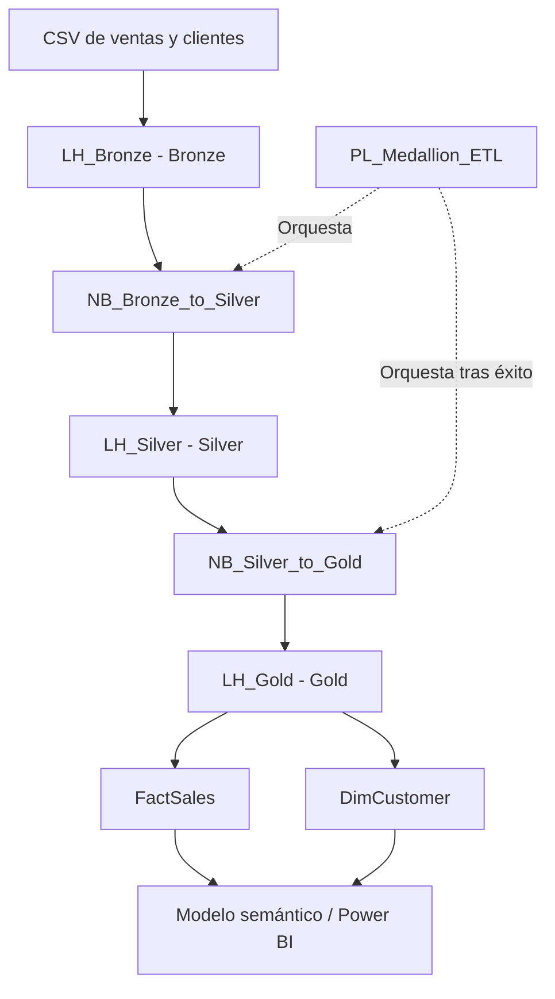

# Microsoft Fabric – Medallion Architecture

Implementación práctica de una arquitectura Medallion (Bronze, Silver y Gold) utilizando Microsoft Fabric, Lakehouse, OneLake, Delta Lake, PySpark y Data Factory Pipelines.

Este proyecto demuestra un flujo de ingeniería de datos de extremo a extremo: desde la ingesta de ficheros CSV hasta la generación de tablas analíticas organizadas en un modelo dimensional.

**Estado del proyecto:** arquitectura Medallion implementada y validada en Microsoft Fabric Trial. Se han ejecutado correctamente los procesos Bronze → Silver → Gold mediante notebooks PySpark, generando las tablas analíticas esperadas. El repositorio incluye datos de ejemplo, notebooks exportados y documentación técnica para reproducir el laboratorio.

## 0. Guía rápida de reproducción del laboratorio

Esta guía permite reproducir el proyecto en un entorno propio de Microsoft Fabric utilizando los ficheros CSV y los notebooks incluidos en este repositorio.

### Paso 1. Preparar el workspace

Crear o seleccionar un workspace de Microsoft Fabric con capacidad suficiente para ejecutar notebooks Spark.

### Paso 2. Crear los Lakehouses

Crear los siguientes Lakehouses:

- `LH_Bronze`: capa Bronze.
- `LH_Silver`: capa Silver.
- `LH_Gold`: capa Gold.

### Paso 3. Cargar los datos de origen

Desde la carpeta `data/` del repositorio, cargar los siguientes ficheros CSV en el Lakehouse `LH_Bronze`:

- `fabric_poc_sales.csv`
- `fabric_poc_customers.csv`

Crear las tablas Delta correspondientes:

- `Bronze_Sales`
- `Bronze_Customers`

### Paso 4. Ejecutar el Notebook Bronze → Silver

Importar `notebooks/01_bronze_to_silver.ipynb` en Microsoft Fabric y asociarlo al Lakehouse correspondiente.

Ejecutar el notebook para generar las siguientes tablas en `LH_Silver`:

- `Sales_Bronze`
- `Customers_Bronze`

### Paso 5. Configurar y ejecutar el Notebook Silver → Gold

Importar `notebooks/02_silver_to_gold.ipynb` y asociarlo a `LH_Gold`.

Antes de ejecutarlo, sustituir los marcadores de configuración de las rutas ABFSS por las rutas correspondientes a las tablas `Sales_Bronze` y `Customers_Bronze` del Lakehouse `LH_Silver`.

Ejecutar el notebook para generar:

- `FactSales`
- `DimCustomer`

### Paso 6. Configurar y ejecutar el pipeline

Recrear el pipeline `PL_Medallion_ETL` y configurar las actividades para ejecutar los dos notebooks en secuencia:

1. `NB_Bronze_to_Silver`
2. `NB_Silver_to_Gold`

La segunda actividad debe ejecutarse únicamente cuando la primera finalice correctamente.

### Paso 7. Validar los resultados

Comprobar que las seis tablas se han generado correctamente y que sus recuentos coinciden con los resultados esperados del laboratorio.

| Capa | Tabla | Registros esperados |
|---|---|---:|
| Bronze | `Bronze_Sales` | 10 |
| Bronze | `Bronze_Customers` | 6 |
| Silver | `Sales_Bronze` | 10 |
| Silver | `Customers_Bronze` | 6 |
| Gold | `FactSales` | 10 |
| Gold | `DimCustomer` | 6 |

**Nota:** los nombres de los Lakehouses, las rutas ABFSS y las configuraciones del entorno deben adaptarse a cada workspace de Microsoft Fabric.

## 1. Objetivos del proyecto

- Implementar una arquitectura Medallion con tres Lakehouses.
- Transformar y validar datos mediante PySpark.
- Persistir los datos en formato Delta Lake.
- Construir una capa Gold con tablas de hechos y dimensiones.
- Orquestar las transformaciones mediante un Data Factory Pipeline.
- Documentar el flujo y las decisiones técnicas.

## 2. Arquitectura

La solución se organiza en tres capas de datos independientes:

| Capa | Lakehouse | Contenido |
|---|---|---|
| Bronze | `LH_Bronze` | CSV originales y tablas `Bronze_Sales`, `Bronze_Customers` |
| Silver | `LH_Silver` | Tablas depuradas `Sales_Bronze`, `Customers_Bronze` |
| Gold | `LH_Gold` | Modelo dimensional: `FactSales`, `DimCustomer` |

### Diagrama de arquitectura



El pipeline `PL_Medallion_ETL` ejecuta los notebooks en secuencia, utilizando la dependencia de éxito entre ambas actividades.

## 3. Tecnologías utilizadas

- **Microsoft Fabric:** plataforma de analítica.
- **OneLake:** almacenamiento unificado de datos.
- **Lakehouse:** organización de datos por capas.
- **Delta Lake:** persistencia transaccional de tablas.
- **Apache Spark / PySpark:** lectura, transformación y escritura de datos.
- **Data Factory Pipelines:** orquestación del proceso ETL.
- **Modelado dimensional:** separación de hechos y dimensiones.

## 4. Datos de origen e ingesta en Bronze

El proyecto utiliza dos ficheros CSV ficticios incluidos en el repositorio:

| Fichero | Descripción |
|---|---|
| `fabric_poc_sales.csv` | Datos de ventas |
| `fabric_poc_customers.csv` | Datos de clientes |

Los ficheros se encuentran en la carpeta `data/` y constituyen la fuente inicial del proceso de ingesta.

### Carga de los ficheros en Microsoft Fabric

Para reproducir la ingesta inicial:

1. Abrir el workspace de Microsoft Fabric.
2. Acceder al Lakehouse `LH_Bronze`.
3. Localizar la sección **Files**.
4. Cargar los ficheros CSV de la carpeta `data/` del repositorio.
5. Utilizar la opción de carga a tablas para crear las tablas Delta correspondientes.

Las tablas resultantes de la capa Bronze son:

- `Bronze_Sales`
- `Bronze_Customers`

Esta capa conserva los datos originales y sirve como punto de partida para las transformaciones posteriores.

## 5. Flujo de datos

El procesamiento se divide en las siguientes etapas:

1. **Ingesta:** carga de los CSV originales de ventas y clientes.
2. **Bronze:** persistencia de los datos de aterrizaje en tablas Delta.
3. **Silver:** conversión de tipos, eliminación de duplicados, validación de campos obligatorios y aplicación de reglas de calidad.
4. **Gold:** selección y organización de los datos en tablas de hechos y dimensiones.
5. **Orquestación:** ejecución secuencial de los notebooks mediante el pipeline.

### Notebooks

| Notebook | Responsabilidad |
|---|---|
| `01_bronze_to_silver.ipynb` | Limpieza, validación y transformación de los datos Bronze a Silver |
| `02_silver_to_gold.ipynb` | Construcción de las tablas de hechos y dimensiones en Gold |

## 6. Modelo dimensional

La capa Gold contiene dos tablas Delta:

- **FactSales:** datos transaccionales de ventas.
- **DimCustomer:** información descriptiva de clientes.

Ambas tablas comparten la clave `CustomerId` y están preparadas para su integración en un modelo semántico de Power BI.

Relación prevista:

`DimCustomer[CustomerId]` (1) → `FactSales[CustomerId]` (*)

La creación del modelo semántico y la configuración de las relaciones se abordarán en una siguiente fase del proyecto.

## 7. Resultados del laboratorio

El proceso se ha ejecutado correctamente y ha generado las siguientes tablas:

| Capa | Tabla | Registros |
|---|---|---:|
| Bronze | Bronze_Sales | 10 |
| Bronze | Bronze_Customers | 6 |
| Silver | Sales_Bronze | 10 |
| Silver | Customers_Bronze | 6 |
| Gold | FactSales | 10 |
| Gold | DimCustomer | 6 |

Los recuentos corresponden al conjunto de datos ficticio utilizado en el laboratorio.

## 8. Decisiones técnicas y consideraciones

- Se utilizan tres Lakehouses para separar responsabilidades y capas de procesamiento.
- Las tablas persistentes se almacenan en formato Delta.
- Las transformaciones se implementan mediante notebooks PySpark.
- Se ha utilizado `overwrite` para facilitar la reproducibilidad del laboratorio. En un entorno productivo sería necesario evaluar cargas incrementales, idempotencia y estrategias de actualización.
- Los errores `TooManyRequestsForCapacity` (HTTP 430) observados durante las primeras ejecuciones evidenciaron las limitaciones de capacidad y concurrencia del entorno Trial. Finalmente, el pipeline se ejecutó correctamente.
- Las rutas ABFS y configuraciones específicas del entorno no se incluyen en el repositorio.

## 9. Estructura del repositorio

```text
fabric-medallion-architecture/
├── README.md
├── .gitignore
├── data/
│   ├── fabric_poc_customers.csv
│   └── fabric_poc_sales.csv
├── notebooks/
│   ├── 01_bronze_to_silver.ipynb
│   └── 02_silver_to_gold.ipynb
├── docs/
│   ├── architecture.md
│   ├── data-flow.md
│   ├── implementation-notes.md
│   └── images/
└── pipelines/
    └── pipeline-design.md
```

## 10. Próximas mejoras

- Documentar las reglas de calidad y las transformaciones PySpark.
- Añadir capturas de los Lakehouses y de las ejecuciones del pipeline.
- Incorporar una dimensión calendario.
- Implementar pruebas de calidad de datos.
- Crear y configurar el modelo semántico de Power BI.
- Explorar cargas incrementales y estrategias de actualización.

---

**Proyecto personal de aprendizaje y portfolio técnico – Microsoft Fabric / DP-600.**